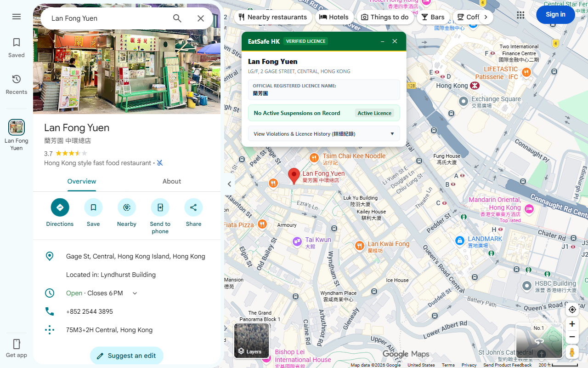

# EatSafe HK

A Chrome extension that shows the Hong Kong FEHD food licence for the restaurant you open on Google Maps.

Open any restaurant, café, bakery or dai pai dong in Hong Kong on Google Maps and a small card appears beside the place panel. It shows:

- whether the venue holds a Food and Environmental Hygiene Department (FEHD) food licence, and which type
- any licence suspension on FEHD's published list, with its dates
- the licence number, district, expiry date and the name the licence is registered under

When several branches share a name, EatSafe HK uses the street address and map pin to pick the right one. If it can't tell them apart, the card says "Unverified Match" instead of guessing.

## Help and feedback

**Found a wrong match, a missing restaurant or a bug?** [Open an issue](../../issues/new). Include:

- the restaurant's name and address as shown on Google Maps
- what the card showed, and what you expected
- a screenshot, if you can

**Common questions**

- **The card doesn't appear.** It only shows for food places in Hong Kong. Check the switch in the toolbar popup (click the puzzle piece, then EatSafe HK) is on.
- **I closed the card and want it back.** ✕ hides it for that restaurant only. Open another place, or reopen the same one later.
- **I want it off everywhere.** Turn off "Show card on Google Maps" in the toolbar popup.
- **The card says "No FEHD Record".** No matching licence was found. Some places operate under another venue's licence (for example inside a hotel or food court), or Google Maps lists them under a different name from their licence.
- **"No suspensions" means the restaurant is clean?** No. It means no suspension order is on FEHD's published list, which covers roughly the past year. FEHD does not publish full inspection or conviction records.

## Data

Licence data comes from FEHD's open data on [DATA.GOV.HK](https://data.gov.hk) (about 42,900 licensed food premises) and FEHD's published list of licence suspensions. It is refreshed every day. Addresses are placed on the map with the HKSAR Government's Address Lookup Service.

## Privacy

The extension reads only the name, address and map pin of the place you open, and uses them to look up its licence. It does not collect your location, browsing history or personal information, and has no ads or analytics. Full policy: [eatsafe-hk.pages.dev/privacy](https://eatsafe-hk.pages.dev/privacy).

## Disclaimer

EatSafe HK is an independent tool. It is not affiliated with FEHD, the HKSAR Government or Google.

## Repository layout

| Path | What it is |
| :--- | :--- |
| `extension/` | The Chrome extension (Manifest V3) |
| `functions/api/` | Lookup API (Cloudflare Pages Functions) |
| `lib/` | Matching, FEHD data parsing and geocoding |
| `migrations/` | Cloudflare D1 database schema |
| `scripts/` | Daily FEHD sync, benchmarks and packaging |
| `public/` | Privacy policy and landing page |
| `.github/workflows/` | Daily FEHD sync job ([details](AUTOMATION_SYNC.md)) |
